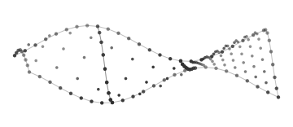
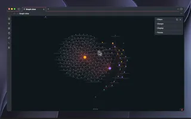
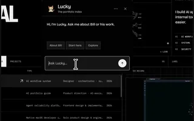

## Hey, I’m Bill

  
  I keep IT running and build AI agents, automations, and little tools for the stuff I’d rather do once.

[Portfolio](https://billcreates.tech/) · [LinkedIn](https://www.linkedin.com/in/aungps/) · [Say hi](mailto:bill@billcreates.tech)

### A couple of highlights

<table>
  <thead>
    <tr>
      <th scope="col" align="left" width="50%"><a href="https://billcreates.tech/case/my-ai-operating-system/">My AI Operating System</a></th>
      <th scope="col" align="left" width="50%"><a href="https://billcreates.tech/work/lucky/">Lucky</a></th>
    </tr>
  </thead>
  <tbody>
    <tr>
      <td>
        <a href="https://billcreates.tech/case/my-ai-operating-system/">
          <picture>
            <source media="(prefers-reduced-motion: reduce)" srcset="./assets/profile/ai-operating-system-poster.webp">
            
          </picture>
        </a>
      </td>
      <td>
        <a href="https://billcreates.tech/work/lucky/">
          <picture>
            <source media="(prefers-reduced-motion: reduce)" srcset="./assets/profile/lucky-poster.webp">
            
          </picture>
        </a>
      </td>
    </tr>
    <tr>
      <td valign="top">A home base for my AI agents so they can pick up where we left off.</td>
      <td valign="top">A corgi guide to my portfolio. Ask him for a tour.</td>
    </tr>
  </tbody>
</table>
