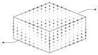
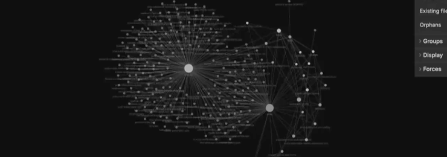
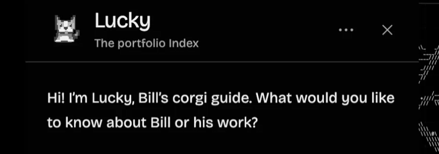

## Hey, I’m Bill

  
  I keep IT running and build AI agents, automations, and little tools for the stuff I’d rather do once.

[Portfolio](https://billcreates.tech/) · [LinkedIn](https://www.linkedin.com/in/aungps/) · [Say hi](mailto:bill@billcreates.tech)

### Things I’ve built

  <a href="https://billcreates.tech/case/my-ai-operating-system/"><strong>My AI Operating System</strong></a> 
  A home base for my AI agents so they can pick up where we left off.

  <a href="https://billcreates.tech/work/lucky/"><strong>Lucky</strong></a> 
  A corgi guide to my portfolio. Ask him for a tour.

